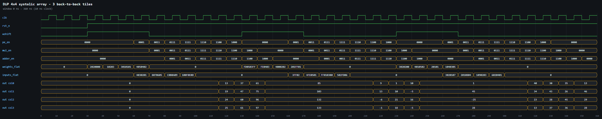
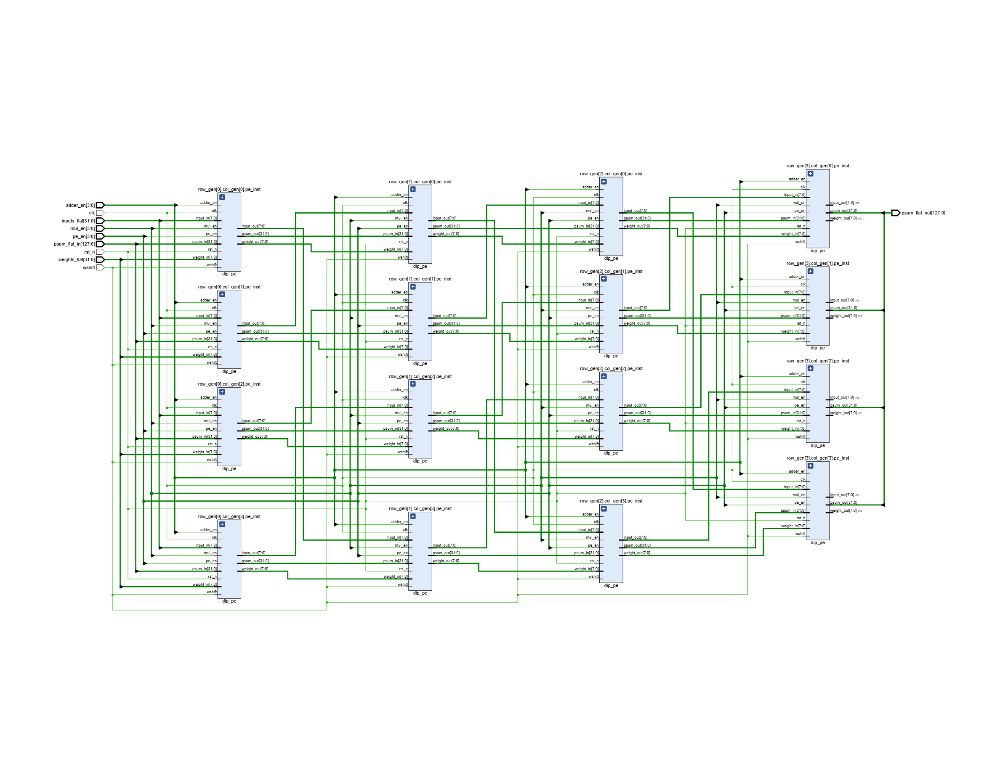
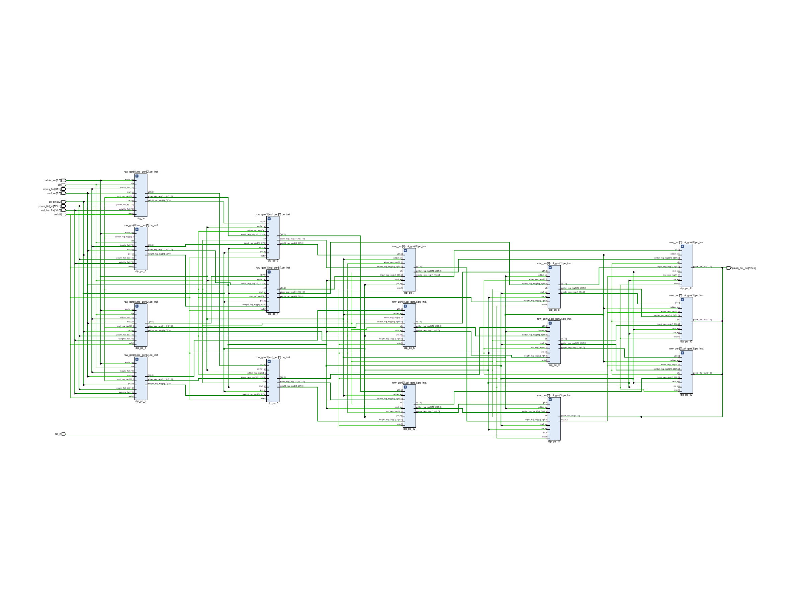

# DiP systolic array

Weight-stationary array with **diagonal input movement**. Row 0 takes the input vector, and each lower row receives the inputs shifted diagonally with wrap-around (`(c+1)%N`), so no input skew/FIFO is needed. Partial sums flow down the columns; the MAC is pipelined (multiply register → add register). Weights are shifted in from the top (`wshift`), which exposes a reload stall between tiles.

## Files

| Folder | Contents |
|---|---|
| [`rtl/`](rtl) | `dip_systolic_array.v` |
| [`tb/`](tb) | `tb_dip_4x4.v` (3 back-to-back tiles, 12 output rows checked; tile period 10 cycles) |
| [`constraints/`](constraints) | `clock.xdc`: 100 MHz clock |
| [`simulation/`](simulation) | waveform image (`waveform.png`, `waveform.svg`), raw dump `waveform.vcd` (open in GTKWave / Vivado), `sim_log.txt` |
| [`synthesis/`](synthesis) | `rtl_schematic` (elaborated design), `synth_schematic` (synthesized netlist), each as .png and .pdf |
| [`reports/`](reports) | `area_utilization.rpt`, `area_utilization_per_module.rpt`, `timing_summary.rpt`, `power.rpt`, `summary.txt` |

## Simulation



```
[cyc 31] PASS  Tile 2 Row 3 = (13, 46, 29, 28)

======================================================
 Rows checked : 12  (expected 12)
 SIMULATION PASSED   Errors = 0
======================================================
```

## Synthesis (xc7k70tfbv676-1, N = 4)

`LUT=1489 FF=1024 DSP=0 WNS_ns=6.360 (100 MHz clock) total_power_W=0.112`

**RTL schematic**



**Synthesized schematic**


