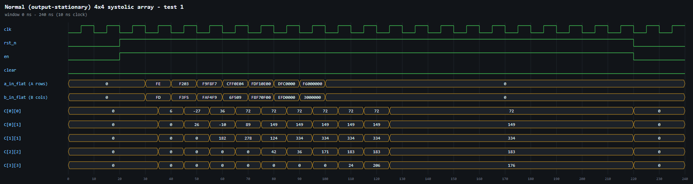
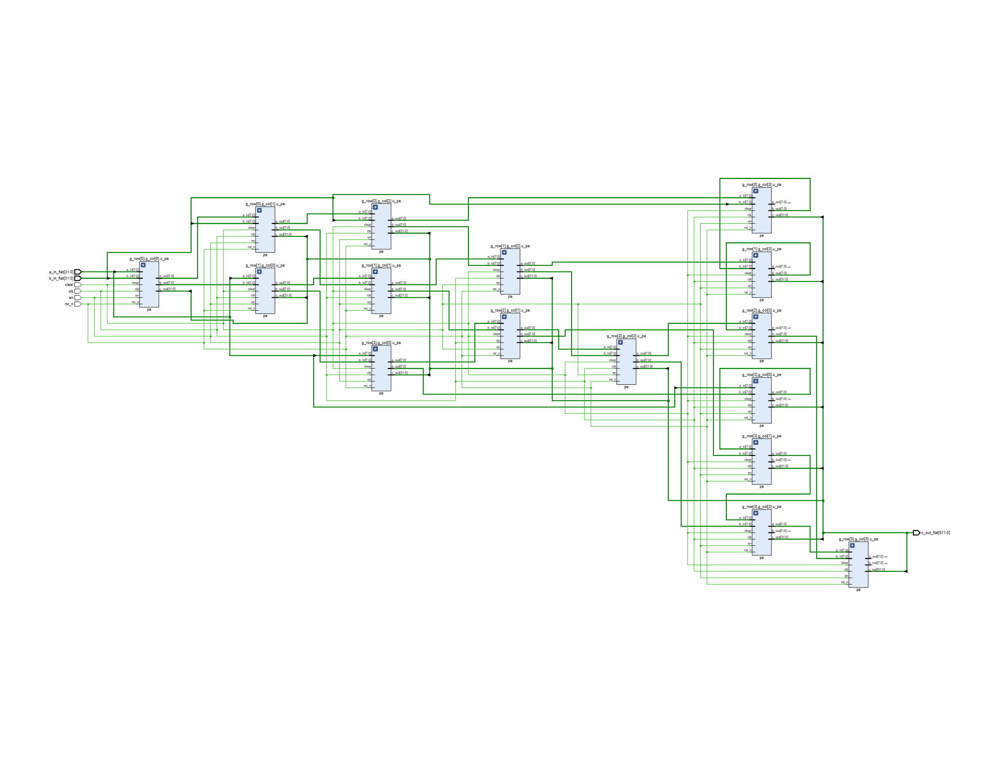
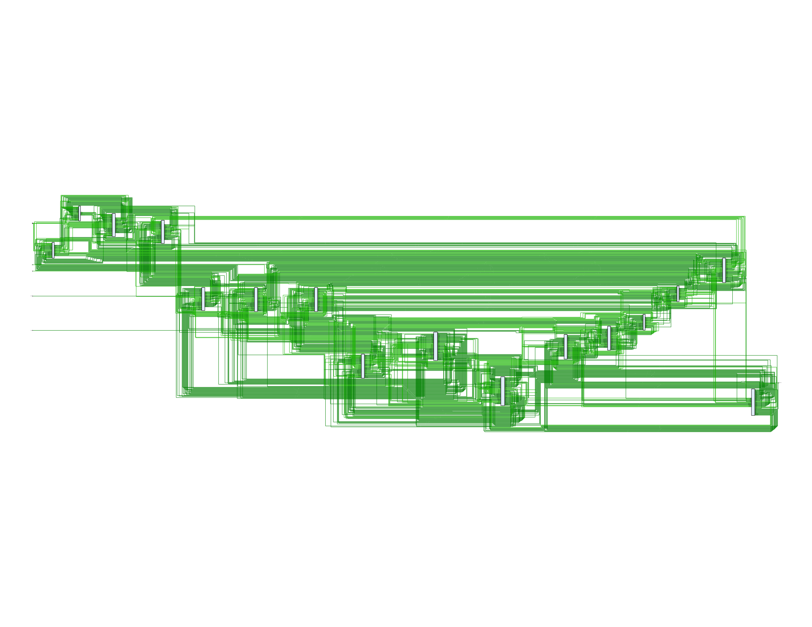

# Normal (output-stationary) systolic array

Conventional N×N systolic array. Row i of A enters from the west and column j of B from the north, each skewed by one cycle. Operands move one PE per clock, and each PE(i,j) accumulates C[i][j] = Σ A[i][k]·B[k][j] in place.

## Files

| Folder | Contents |
|---|---|
| [`rtl/`](rtl) | `pe.v`, `systolic_array.v` |
| [`tb/`](tb) | `tb_systolic.v` (20 random signed 4×4 matrix multiplies, checked against a golden model) |
| [`constraints/`](constraints) | `clock.xdc`: 100 MHz clock |
| [`simulation/`](simulation) | waveform image (`waveform.png`, `waveform.svg`), raw dump `waveform.vcd` (open in GTKWave / Vivado), `sim_log.txt` |
| [`synthesis/`](synthesis) | `rtl_schematic` (elaborated design), `synth_schematic` (synthesized netlist), each as .png and .pdf |
| [`reports/`](reports) | `area_utilization.rpt`, `area_utilization_per_module.rpt`, `timing_summary.rpt`, `power.rpt`, `summary.txt` |

## Simulation



```
  test 18: PASS
  test 19: PASS
  test 20: PASS
================================================
ALL 20 TESTS PASSED
================================================
```

## Synthesis (xc7k70tfbv676-1, N = 4)

`LUT=1474 FF=704 DSP=0 WNS_ns=5.123 (100 MHz clock) total_power_W=0.113`

**RTL schematic**



**Synthesized schematic**


