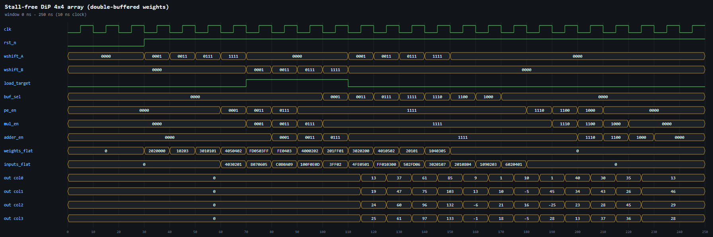
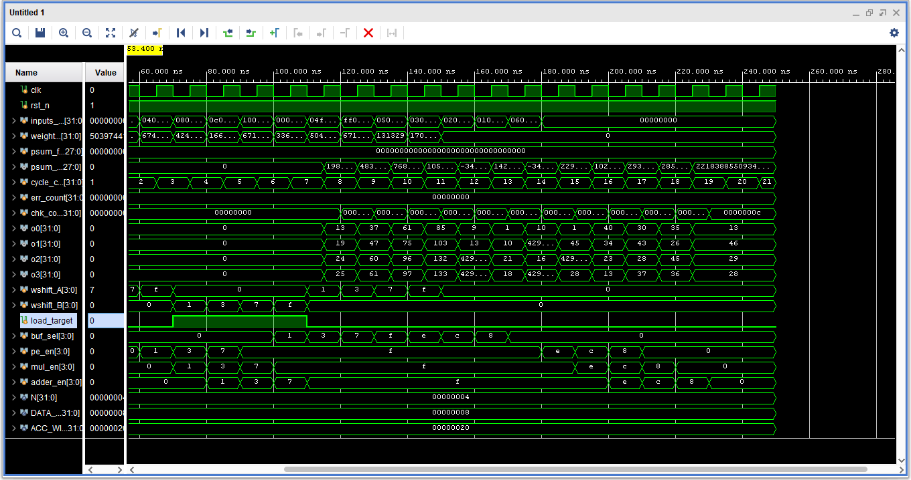
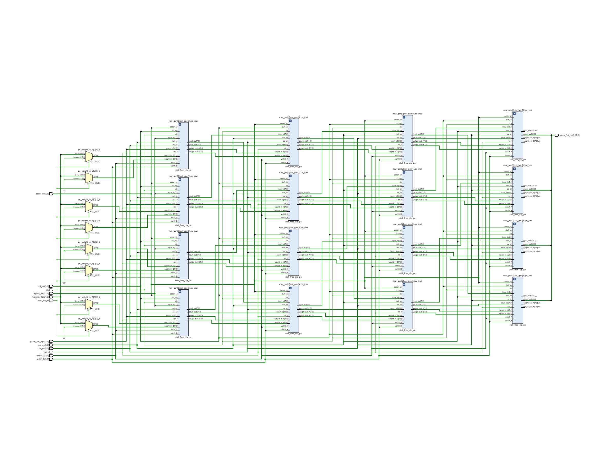
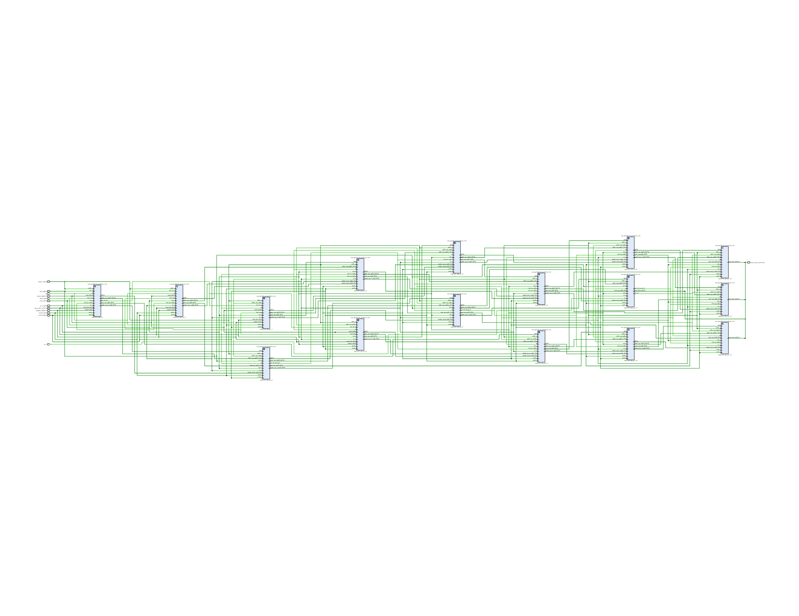

# Stall-free DiP systolic array

Same diagonal input path, vertical psum path and 2-stage MAC as DiP. The only change is **double-buffered weights**: two independent weight shift chains (A and B). The next tile's weights load into the shadow buffer while the active one feeds the MAC, and a per-row `buf_sel` (pipelined with the inputs) swaps them in step with the diagonal wave.

## Files

| Folder | Contents |
|---|---|
| [`rtl/`](rtl) | `stall_free_dip_array.v` |
| [`tb/`](tb) | `tb_stall_free_dip_4x4.v` (same 3 tiles as the DiP TB; tile period 4 cycles, last output at cycle 19 vs 31) |
| [`constraints/`](constraints) | `clock.xdc`: 100 MHz clock |
| [`simulation/`](simulation) | waveform image (`waveform.png`, `waveform.svg`), raw dump `waveform.vcd` (open in GTKWave / Vivado), `sim_log.txt`, plus `vivado_waveform_*.png` (screenshots from the Vivado simulator) |
| [`synthesis/`](synthesis) | `rtl_schematic` (elaborated design), `synth_schematic` (synthesized netlist), each as .png and .pdf |
| [`reports/`](reports) | `area_utilization.rpt`, `area_utilization_per_module.rpt`, `timing_summary.rpt`, `power.rpt`, `summary.txt` |

## Simulation



Vivado simulator view:



```

======================================================
 Rows checked : 12  (expected 12)
 SIMULATION PASSED   Errors = 0
 period 4 vs baseline 10 ; last output 19 vs 31
======================================================
```

## Synthesis (xc7k70tfbv676-1, N = 4)

`LUT=1777 FF=1156 DSP=0 WNS_ns=5.914 (100 MHz clock) total_power_W=0.113`

**RTL schematic**



**Synthesized schematic**


